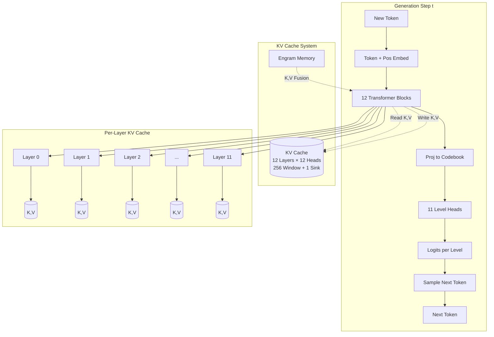
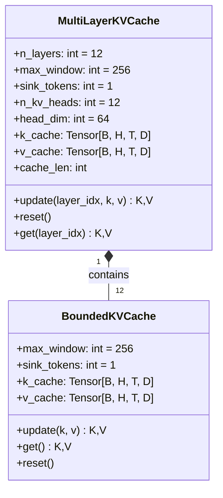
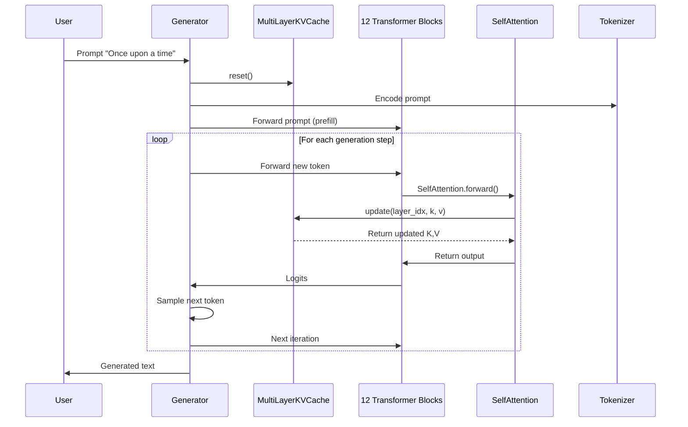
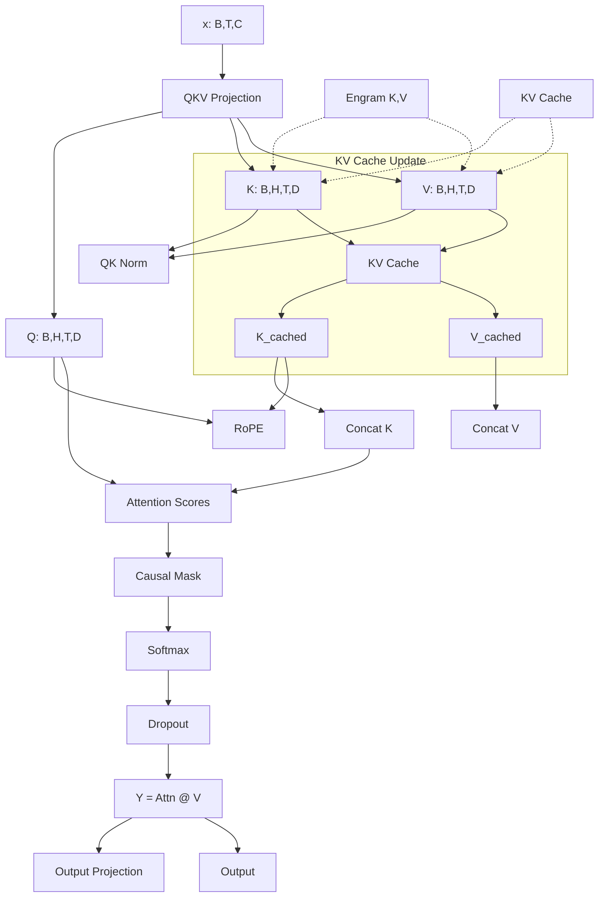
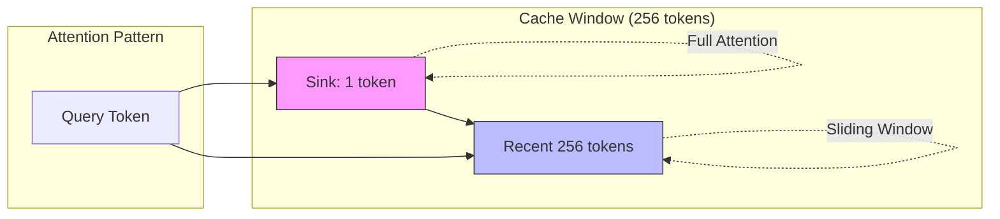
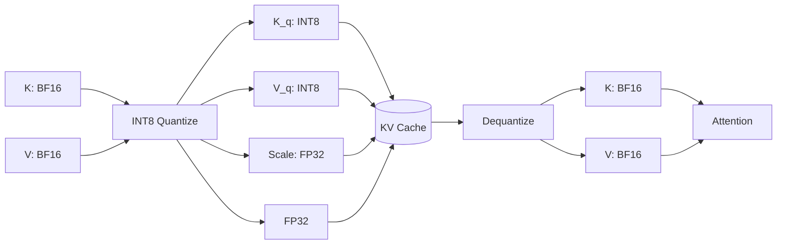
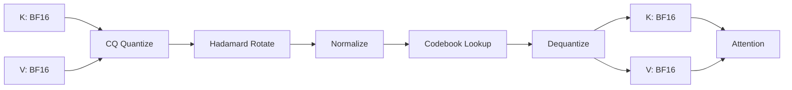
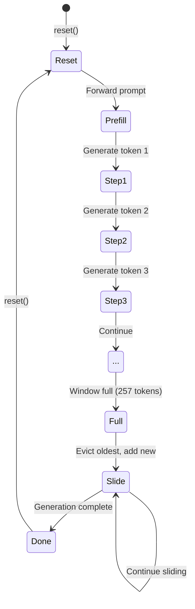

# KV Cache Architecture in NCM-MoE-Engram-KVCache

## Overview

The KV (Key-Value) Cache is a critical optimization for autoregressive generation in transformer models. Instead of recomputing key and value projections for all previous tokens at each generation step, we cache them and only compute for the new token.

In this NCM-MoE-Engram model, the KV cache serves **12 transformer layers** with **Multi-Head Attention (MHA)** across **11 generation levels** (levels 1-11, skipping level 0 which is the prefix).

---

## Architecture Overview



---

## KV Cache Data Structure



### Tensor Shapes

| Component | Shape | Description |
|-----------|-------|-------------|
| `k_cache` per layer | `[B, H, T_cached, D]` | Key cache per layer |
| `v_cache` per layer | `[B, H, T_cached, D]` | Value cache per layer |
| `B` | 1-4 | Batch size |
| `H` | 12 | Number of KV heads (MHA) |
| `T_cached` | ≤ 257 | Cached sequence length (256 window + 1 sink) |
| `D` | 64 | Head dimension (768/12) |

---

## KV Cache in Generation Flow



---

## Attention with KV Cache



---

## Sliding Window + Attention Sink



### Configuration
```python
# In models/kv_cache.py
max_window = 256      # Sliding window size
sink_tokens = 1       # Prefix length (NCM prefix_len=1)
n_kv_heads = 12       # MHA (not GQA) for NCM compatibility
head_dim = 64         # 768 / 12
```

### Why 1 Sink Token?
- NCM uses `prefix_len=1` for hierarchical generation
- The first token acts as attention sink (StreamingLLM pattern)
- Prevents attention degradation in long sequences

---

## INT8 Quantization (BF16 Model)



### Quantization Details
```python
# models/kv_cache.py
def quantize_int8(x):
    # Per-head per-channel asymmetric quantization
    scale = x.abs().max(dim=-2, keepdim=True).values / 127
    x_q = torch.round(x / scale).clamp(-128, 127).to(torch.int8)
    return x_q, scale

def dequantize_int8(x_q, scale):
    return x_q.to(torch.bfloat16) * scale
```

- **Per-head per-channel**: Each head/channel gets independent scale
- **Storage**: INT8 (1 byte) + FP32 scale (4 bytes) = 5 bytes vs 2 bytes BF16
- **Savings**: ~2× compression for KV cache

---

## 2-bit CQ Quantization (Native 2-bit Branch)



### CQ Pipeline
```python
def cq_quantize_kv(k, v, bits=2.0, group_size=64):
    # 1. Reshape to groups
    # 2. Hadamard rotation (spreads information)
    # 3. Normalize to unit sphere
    # 3. Codebook lookup (Lloyd-Max for Gaussian)
    # 4. Dequantize: codebook * norm
    # 5. Inverse Hadamard
    # 4. Return quantized + norms for dequantization
    return k_q, k_norm, v_q, v_norm
```

### 2-bit Codebook (Lloyd-Max for Gaussian)
| Bits | Levels | Example Values |
|------|--------|----------------|
| 2-bit | 4 | [-0.134, -0.040, 0.040, 0.134] |
| 1.58-bit (ternary) | 3 | [-1.224, 0, +1.224] |

---

## Cache State During Generation



### Cache State at Step N
| Step | Cache Length | Sink | Window | Total |
|------|-------------|------|--------|-------|
| 1 (prefill) | 128 | 1 | 127 | 128 |
| 1 | 129 | 1 | 128 | 129 |
| ... | ... | 1 | 256 | 257 |
| 129+ | 257 | 1 | 256 | 257 (sliding) |

---

## Integration Points in Model

```mermaid
graph TB
    subgraph "MoEEngramNextConceptTransformer"
        Forward[forward()] --> MultiLevel{forward_multilevel}
        MultiLevel --> ProjFrom[proj_from_codebook]
        ProjFrom --> EmbAdd[Add Embeddings]
        EmbAdd --> Blocks[12 Blocks]
        
        subgraph "Block i"
            Block --> LN1[LayerNorm 1]
            LN1 --> Attn[SelfAttention]
            Attn --> KV[KV Cache]
            Attn --> Engram[Engram KV]
            Attn --> LN2[LayerNorm 2]
            LN2 --> MoE[MoE Block]
        end
        
        Blocks --> LNf[Final LayerNorm]
        LNf --> ProjTo[proj_to_codebook]
        ProjTo --> Heads[11 Level Heads]
        Heads --> Logits
    end
    
    KVCache[KV Cache] -.->|Read/Write| Blocks
    Engram[Engram Memory] -.->|K,V Fusion| Blocks
```

### Key Integration Points

| Location | Component | KV Cache Interaction |
|----------|-----------|---------------------|
| `SelfAttention.forward()` | Attention | `kv_cache.update(layer_idx, k, v)` |
| `Block.forward()` | Block | Passes `kv_cache` to attention |
| `Block2Bit.forward()` | 2-bit Block | Same interface |
| `generate()` | Generation | `kv_cache.reset()` at start |
| `forward_single_level()` | Single-level | Passes `kv_cache` to blocks |

---

## Code References

| File | Key Functions |
|------|---------------|
| `models/kv_cache.py` | `BoundedKVCache`, `MultiLayerKVCache`, `quantize_int8`, `dequantize_int8` |
| `models/common.py` | `SelfAttention.forward()` - KV cache integration |
| `models/moe_engram_generator.py` | `forward_multilevel()`, `forward_single_level()`, `generate()` |
| `models/moe_engram_generator_2bit.py` | 2-bit versions with CQ quantization |
| `models/kv_cache.py` | `quantize_int8()`, `dequantize_int8()`, `cq_quantize_kv()` |

---

## Performance Characteristics

| Metric | BF16 (INT8 KV) | 2-bit Native |
|--------|----------------|--------------|
| KV Cache Size | ~4.5 MB | ~1.1 MB |
| Quantization Overhead | Low (INT8) | Medium (CQ) |
| Dequant Latency | Negligible | Low (Hadamard) |
| Quality Loss | <0.1 PPL | <0.5 PPL target |
| VRAM Savings | 2× | 4× |

---

## Debugging KV Cache

```python
# Check cache state
model.kv_cache.cache_len  # Current length
model.kv_cache.get(layer_idx)  # Get K,V for layer

# Verify shapes
k, v = model.kv_cache.get(0)
print(f"K: {k.shape}, V: {v.shape}")  # [B, H, T, D]

# Reset between generations
model.kv_cache.reset()

# Check for NaN
assert not torch.isnan(model.kv_cache.k_cache).any()
```

---

## Summary

The KV cache in NCM-MoE-Engram-KVCache:

1. **Per-layer**: 12 independent caches (one per transformer layer)
2. **MHA**: 12 heads × 64 dim = 768 dim per layer
3. **Window**: 256 tokens + 1 sink token = 257 max
4. **Quantization**: INT8 (BF16 model) / 2-bit CQ (native 2-bit)
5. **Integration**: Transparent in `SelfAttention.forward()` via `kv_cache.update()`
6. **Generation**: Reset at start, accumulates during autoregressive decoding
7. **Sliding**: Automatic eviction when window full (StreamingLLM pattern)

The KV cache is the primary memory optimization enabling long-form generation on 6GB VRAM.